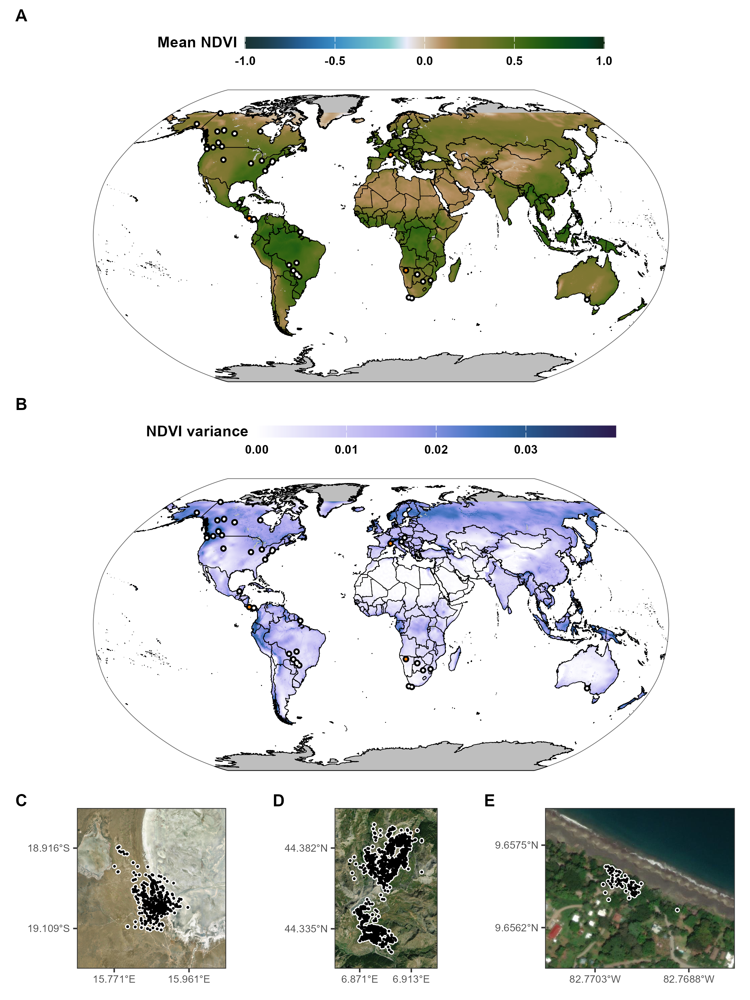
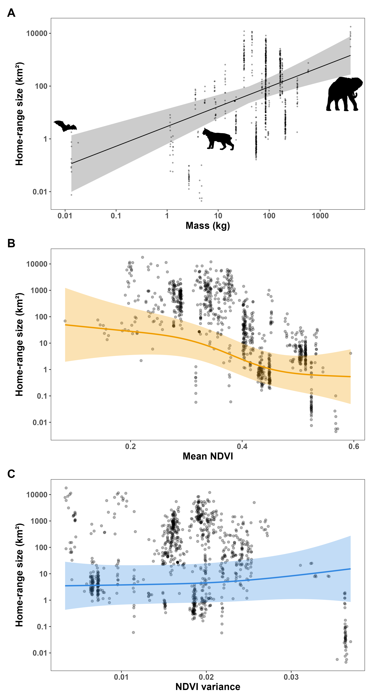

<!-- submission guidelines for Science:
- www.science.org/content/page/science-information-authors
- www.science.org/content/page/instructions-preparing-initial-manuscript

- < 3000 words for the main text
- 3 display items (figures or tables) with brief legends
- about 50 main-text references
- structured acknowledgments section

- main text divided into sections with brief subheadings
- "Materials and Methods" should be included in supplementary materials w sufficient detail to replicate the study. This should be followed by additional data and figures needed to support the paper’s conclusions.
- All data must be available in either the main text or the supplementary materials or must be deposited at a publicly accessible repository and cited in the paper. For more on our open data policy, including information on our partnership with Dryad, please see the “Data and Code Deposition” section of our Editorial Policies.

Research Articles that are not a good fit for our print format:
- often have more than 4 figures
- will be included in all digital versions of Science
- a one-page summary (~500 words, divided into four sections: “Introduction,” “Rationale,” “Results,” and “Conclusion”) plus a summary figure and caption (no more than 65 words) will be included in the print version.
- The methods section runs after the main text as part of the article, but other additional information to support the paper’s conclusions remains as supplementary material.
-->

```{r setup, include=FALSE}
# set chunk defaults: don't print code, images text width and centered
knitr::opts_chunk$set(echo = FALSE, out.width = '\\textwidth',
                      fig.align = 'center', cache = TRUE, warning = FALSE,
                      message = FALSE)
```

\newpage

Alternative titles:

* Environmental stochasticity drives mammals to expand their ranges
* Mean conditions are insufficient for predicting animal movement
* Average is not enough: environmental stochasticity drives home range expansion of mammals
* Moving beyond the average: environmental stochasticity as a driver of mammalian movement

\newpage

<!--
available text sizes:
Huge > huge > LARGE > Large > large > normalsize > small > footnotesize > scriptsize > tiny
-->

```{r abstract, echo=FALSE}
abstract <- "The range size of an animal is often used of as a proxy for the animal's overall needs while also accounting for several latent variables, such as access to resources, vagility, competition, predation, and reproductive behaviour. Animals' average range sizes follow a strong power relationship with the animals' average mass and an exponent near 3/4, which suggests that average range sizes scale with animals' average metabolic needs. However, such a model only explains approximately 80% of the deviance in range size at the individual level. A great majority of the remaining 20% can be explained by accouning for inidividual-level variation in resource abundance and stochasticity (unpredictability). Using a large GPS dataset of 1599 terrestrial mammals, we present empirical evidence that the combination of mean and variance in NDVI explain causes them to expand their range, spend more time exploring, and move faster and more ballistically throughout the landscape. Our results suggest that growing environmental stochasticity will..."
n_words_abstract <- stringi::stri_count_words(abstract)
if (FALSE){
  n_words_abstract
}
```

\clearpage

\noindent \textbf{Article type}: Research article

\noindent \textbf{Words in abstract}: `r n_words_abstract`

```{r}
if (n_words_abstract > 300) warning(paste("Abstract has", n_words_abstract, "> 300 words!"))
```

\noindent \textbf{Words in main text}: `r suppressMessages(wordcountaddin::word_count()) - 25` <!-- does not include abstract or figure captions; "- 25" approximately removes the stuff on page 2 -->

\noindent \textbf{Figures}: 0

\noindent \textbf{Tables}: 0

\noindent \textbf{References}: XXX

\noindent \textbf{Appendices}: 0

\noindent \textbf{Key words:} XXX

\noindent \textbf{Contact Information:} *Corresponding author’s telephone, and email details*

\ 

\clearpage

# Abstract {-}

\noindent `r abstract`

<!-- start main body on a new page -->
\newpage

\doublespacing

\linenumbers

# Introduction

like H = C / R paper [@harestad_home_1979], but:
- R is now a random variable with mean and variation around the mean
- Increased interest in environmental stochasticity has promoted thinking of env stoch (unpredictability) as a driver of animal movement (https://www.sciencedirect.com/science/article/pii/S0169534719302885)
- variance in R is also important
- relationship can now be nonlinear
- because both factors are occurring at once and interacting, a multivariate approach is essential [@polazzo_measuring_2024]

@mezzini_how_2025

@brown_toward_2004

mass-only model explains ~80% of deviance

https://pubmed.ncbi.nlm.nih.gov/23020517/

* Migrating animals will have larger range sizes and smaller EDF values, and they will also be more susceptible to interannual variation. 
These two points work well together because they imply we should estimate changes in the mean as smooth changes that occur across years rather than among years, which means i should keep the k for years relatively low (e.g., (2025 - 1981) / 4 = 11 ≈ 10)


wolverines have very low E(R), very large HR, and cache food

human activity is increasing stochasticity and conseuqnetly HR size, but it's also constraining movement capacities (Tucker paper) and attracting to urban traps

follow up after main figure:
- effects of HFI
- changes in variance over time: spatial needs will increase in the future, exacerbating issues
- increases in variances => increases in movement rates => increases in energy expenditure, which increases HR size further? what if animals can't achieve an energetic balance?
- increases in variances => increases in movement rates => increases in encounter rates => how will this affect trophic structures and predation rates? what if prey are forced to alter the predator/prey dynamics to try to survive?
- increases in env var can have strong cascading effects that then increase the var of other processes and lead to a series of strong cascades and maybe collapse

papers to use for structure:
- jetz scaling of animal space use (https://pubmed.ncbi.nlm.nih.gov/15472074/)
  - tucker moving in the anthropocene (https://www.science.org/doi/10.1126/science.aam9712)
- the search behavior of terrestrial mammals (https://www.biorxiv.org/content/10.1101/2022.12.31.521874v1)

artificial feeding can alter community structures in ways that are not reflected by NDVI: https://doi.org/10.1002/ecs2.70368

tapir results from first paper match the main figure! variance has u-shaped effect at low means: some variance at low means is beneficial because it allows to move across patches as they deplete, if animal can find good patches.

useful refs:
- uses ndvi variance: https://esajournals.onlinelibrary.wiley.com/doi/full/10.1002/ecm.1348
- 

```{r data-fig, fig.cap = "Caption"}

```


```{r results-fig, fig.cap = "Caption"}

```

# Materials and Methods

for buffalo data, cite:

- W. M. Getz, S. Fortmann-Roe, P. C. Cross, A. J. Lyons, S. J. Ryan, C. C. Wilmers. LoCoH: Nonparameteric kernel methods for constructing home ranges and utilization distributions. PLoS ONE 2:2, e207 (2007).
- P. C. Cross, J. A. Bowers, C. T. Hay, J. Wolhuter, P. Buss, M. Hofmeyr, J. T. du Toit, W. M. Getz. Data from: Nonparameteric kernel methods for constructing home ranges and utilization distributions. Movebank Data Repository. DOI:10.5441/001/1.j900f88t (2016).

for coati data, cite:

- R. A. Powell, S. Ellwood, R. Kays. Stink or swim: techniques to meet the challenges for the study and conservation of small critters that hide, swim or climb and may otherwise make themselves unpleasant. In L. Harrington and D. W. Macdonald; Biology and Conservation of Mustelids and Procyonids (in preparation).
- R. Kays, B. T. Hirsch Data from: Stink or swim: techniques to meet the challenges for the study and conservation of small critters that hide, swim or climb and may otherwise make themselves unpleasant. Movebank Data Repository. DOI:10.5441/001/1.41076dq1 (2015).

for maned wolf, contact: Rogerio Cunha de Paula (rogercunha\@gmail.com)


\clearpage

# References and notes

\references

# Acknowledgments